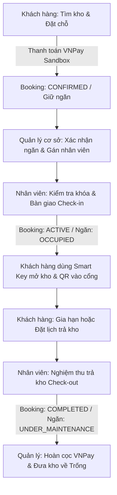

# 📋 HƯỚNG DẪN KIỂM THỬ TOÀN DIỆN HỆ THỐNG KHOMINI (TESTING GUIDE)

> **Tài liệu kiểm thử dành cho:** Nhà phát triển, Giảng viên đánh giá đồ án, Đội ngũ QA/Tester.  
> **Phiên bản:** 2.0 (Cập nhật hoàn thiện luồng Khóa thông minh PIN 6 số, QR Ra vào cổng, VNPay Sandbox, và Quản lý 5 Role).

---

## 📑 MỤC LỤC
1. [Tổng quan hệ thống & Kiến trúc](#1-tổng-quan-hệ-thống--kiến-trúc)
2. [Bảng tài khoản kiểm thử mặc định theo Role](#2-bảng-tài-khoản-kiểm-thử-mặc-định-theo-role)
3. [Thiết lập môi trường kiểm thử (Quick Start)](#3-thiết-lập-môi-trường-kiểm-thử-quick-start)
4. [Kịch bản kiểm thử 5 Luồng cốt lõi (Core End-to-End Flows)](#4-kịch-bản-kiểm-thử-5-luồng-cốt-lõi-core-end-to-end-flows)
   - [Flow 1: Khám phá kho, Đặt giữ chỗ & Thanh toán VNPay](#flow-1-khám-phá-kho-đặt-giữ-chỗ--thanh-toán-vnpay)
   - [Flow 2: Phân công & Nhân viên Bàn giao kho (Check-in)](#flow-2-phân-công--nhân-viên-bàn-giao-kho-check-in)
   - [Flow 3: Vận hành Khóa thông minh (Smart Key & QR Cổng)](#flow-3-vận-hành-khóa-thông-minh-smart-key--qr-cổng)
   - [Flow 4: Gia hạn hợp đồng, Yêu cầu hỗ trợ & Báo cáo quản trị](#flow-4-gia-hạn-hợp-đồng-yêu-cầu-hỗ-trợ--báo-cáo-quản-trị)
   - [Flow 5: Trả kho (Check-out), Nghiệm thu & Hoàn tiền cọc](#flow-5-trả-kho-check-out-nghiệm-thu--hoàn-tiền-cọc)
5. [Kiểm thử các trường hợp đặc biệt & Bảo mật (Edge Cases)](#5-kiểm-thử-các-trường-hợp-đặc-biệt--bảo-mật-edge-cases)
6. [Bảng kiểm tra trạng thái dữ liệu (State Verification Matrix)](#6-bảng-kiểm-tra-trạng-thái-dữ-liệu-state-verification-matrix)

---

## 1. Tổng quan hệ thống & Kiến trúc

KhoMini là nền tảng quản lý và cho thuê kho mini tự quản thông minh (**Smart Self-Storage**), bao gồm:
- **Backend (BE):** Java 17, Spring Boot 3, Spring Security (JWT), PostgreSQL, Flyway, VNPay Sandbox API, Cloudinary.
- **Frontend (FE):** Flutter Cross-platform (Android, iOS), chuẩn giao diện Material 3 hiện đại, bảo mật lưu trữ mã PIN cục bộ (SharedPreferences mã hóa).

### Sơ đồ luồng tổng quát:


---

## 2. Bảng tài khoản kiểm thử mặc định theo Role

Hệ thống đã nạp sẵn dữ liệu khởi tạo (Seed Data) cho 5 nhóm vai trò người dùng trong tệp `SeedConfig.java`. Mật khẩu mặc định tương ứng với tên vai trò viết thường:

| Role (Vai trò) | Email đăng nhập | Mật khẩu | Chi nhánh / Cơ sở | Phạm vi & Chức năng chính |
| :--- | :--- | :--- | :--- | :--- |
| **CUSTOMER** *(Khách hàng 1)* | `customer@gmail.com` | `customer` | Tự do | Đã có sẵn 2 kho đang thuê (`S-101` mã PIN `123456`, `M-201` sắp hết hạn để test gia hạn), 1 đơn chờ thanh toán, 2 support tickets. |
| **CUSTOMER** *(Khách hàng 2)* | `customer2@gmail.com` | `customer` | Tự do | Đã có sẵn 1 đơn đã xác nhận chờ nhận kho (`L-301`), 1 đơn đã trả kho chờ nhận lại cọc (`S-102`), 1 đơn tại Thủ Đức (`HCM-TD`). |
| **CUSTOMER** *(Khách hàng 3)* | `customer3@gmail.com` | `customer` | Tự do | Đã có sẵn đơn thuê tại Quận 7 (`HCM-D7`) và đang nằm trong Hàng đợi (Waitlist) kho Large Quận 1. |
| **STAFF** *(Nhân viên 1)* | `staff1@gmail.com` | `staff` | HCM-D1 (Quận 1) | Xem lịch bàn giao hôm nay (`L-301`), quét mã QR cổng, bảo trì ngăn (`S-102`), xử lý support ticket. |
| **STAFF** *(Nhân viên 2)* | `staff2@gmail.com` | `staff` | HCM-D1 (Quận 1) | Nhân viên hỗ trợ cơ sở Quận 1, tiếp nhận lịch phân công ca làm việc. |
| **STAFF** *(Nhân viên 3)* | `staff3@gmail.com` | `staff` | HCM-D7 (Quận 7) | Nhân viên trực tại cơ sở Quận 7, xử lý hỗ trợ và bàn giao kho tại Quận 7. |
| **STAFF** *(Nhân viên 5)* | `staff5@gmail.com` | `staff` | HCM-TD (Thủ Đức) | Nhân viên trực tại cơ sở Thủ Đức, xử lý hỗ trợ và bàn giao kho tại Thủ Đức. |
| **STAFF** *(Nhân viên 6)* | `staff6@gmail.com` | `staff` | HCM-TD (Thủ Đức) | Nhân viên hỗ trợ cơ sở Thủ Đức, thực hiện kiểm tra và nghiệm thu kho. |
| **STAFF** *(Nhân viên 7)* | `staff7@gmail.com` | `staff` | HCM-D7 (Quận 7) | Nhân viên hỗ trợ cơ sở Quận 7, tiếp nhận phân công lịch hẹn. |
| **STAFF** *(Nhân viên dự phòng)* | `staff4@gmail.com` | `staff` | *Chưa gán cơ sở* | Dùng để kiểm thử tính năng "Thêm / Phân công nhân viên vào cơ sở" của Quản lý cơ sở. |
| **STAFF** *(Nhân viên dự phòng 2)* | `staff8@gmail.com` | `staff` | *Chưa gán cơ sở* | Dùng để kiểm thử tính năng "Thêm / Phân công nhân viên vào cơ sở" của Quản lý cơ sở. |
| **STAFF** *(Nhân viên dự phòng 3)* | `staff9@gmail.com` | `staff` | *Chưa gán cơ sở* | Dùng để kiểm thử tính năng "Thêm / Phân công nhân viên vào cơ sở" của Quản lý cơ sở. |
| **FACILITY_MANAGER** *(Quản lý Q1)* | `facility1@gmail.com` | `facility` | HCM-D1 (Quận 1) | Quản lý ngăn kho, phân công nhận kho (`L-301`), duyệt hoàn cọc chuyển khoản (`S-102`), giao ticket cho nhân viên. |
| **FACILITY_MANAGER** *(Quản lý Q7)* | `facility2@gmail.com` | `facility` | HCM-D7 (Quận 7) | Quản lý cơ sở Quận 7: điều phối ngăn kho, phân công nhân viên Q7, duyệt hoàn cọc, xử lý ticket. |
| **FACILITY_MANAGER** *(Quản lý Thủ Đức)*| `facility3@gmail.com` | `facility` | HCM-TD (Thủ Đức) | Quản lý cơ sở Thủ Đức: điều phối ngăn kho, phân công nhân viên Thủ Đức, duyệt hoàn cọc, xử lý ticket. |
| **FACILITY_MANAGER** *(Quản lý dự phòng)*| `facility4@gmail.com` | `facility` | *Chưa gán cơ sở* | Dùng để kiểm thử tính năng "Gán quản lý cho cơ sở" của Quản trị viên (Admin). |
| **FACILITY_MANAGER** *(Quản lý dự phòng 2)*| `facility5@gmail.com` | `facility` | *Chưa gán cơ sở* | Dùng để kiểm thử tính năng "Gán quản lý cho cơ sở" của Quản trị viên (Admin). |
| **BUSINESS_MANAGER** *(Quản lý vận hành)* | `business@gmail.com` | `business` | Toàn hệ thống | Xem báo cáo tài chính/doanh thu đa cơ sở có sẵn số liệu & biểu đồ, tỷ lệ lấp đầy kho, điều chỉnh bảng giá niêm yết, chính sách. |
| **ADMIN** *(Quản trị viên)* | `admin@gmail.com` | `admin` | Toàn hệ thống | Quản trị tài khoản, phân quyền Role, xem toàn bộ nhật ký kiểm toán hệ thống (Audit Activity Logs) đã có sẵn dữ liệu. |

---

## 2.1. Bảng kịch bản dữ liệu có sẵn để thao tác ngay (Pre-seeded Test Scenarios)

Để bạn có thể kiểm thử ngay lập tức mà không cần tự tạo dữ liệu từ đầu, hệ thống đã nạp sẵn các kịch bản thực tế sau:

| Mã ngăn | Cơ sở | Trạng thái ngăn | Trạng thái Booking | Tài khoản sở hữu | Dữ liệu kiểm thử có sẵn | Thao tác kiểm thử ngay |
| :--- | :--- | :--- | :--- | :--- | :--- | :--- |
| **S-101** | HCM-D1 | `OCCUPIED` | `ACTIVE` | `customer@gmail.com` | PIN: **`123456`**, Cửa: Đang Khóa | Mở kho của tôi -> Khóa thông minh: Thử mở khóa với mã `123456`, đổi PIN, đặt lại PIN khi quên, tạo QR vào cổng. |
| **M-201** | HCM-D1 | `OCCUPIED` | `ACTIVE` | `customer@gmail.com` | PIN: **`888999`**, Hạn còn **2 ngày** | Thử tính năng **Gia hạn thời gian thuê** (Flow 4) hoặc bấm **Yêu cầu trả kho** nhập số tài khoản ngân hàng (Flow 5). |
| **M-202** | HCM-D1 | `RESERVED` | `PENDING_PAYMENT` | `customer@gmail.com` | Còn 25 phút hết hạn | Mở tab Khám phá / Thanh toán -> Mục "Đơn chờ thanh toán": Thử bấm **Thanh toán ngay** hoặc bấm **Hủy đơn**. |
| **L-301** | HCM-D1 | `RESERVED` | `CONFIRMED` | `customer2@gmail.com` | Lịch hẹn check-in: **Hôm nay** | - Đăng nhập `facility1@gmail.com`: Vào Booking Assignment để gán ngăn/staff.<br>- Đăng nhập `staff1@gmail.com`: Vào Lịch hôm nay -> Bấm **Check-in**. |
| **S-102** | HCM-D1 | `UNDER_MAINTENANCE` | `COMPLETED` | `customer2@gmail.com` | Yêu cầu hoàn cọc 500k VNĐ (VCB) | - Đăng nhập `facility1@gmail.com`: Vào "Duyệt hoàn tiền cọc" -> Bấm **Xác nhận chuyển khoản**.<br>- Đăng nhập `staff1@gmail.com`: Vào Ngăn kho -> Chuyển về `AVAILABLE`. |
| **TK-HCM-001** | HCM-D1 | Ticket sự cố PIN | `IN_PROGRESS` | `customer@gmail.com` | Gán cho: `staff1@gmail.com` | Đăng nhập `staff1@gmail.com`: Vào Support Ticket -> Cập nhật trạng thái sang `RESOLVED`. |
| **TK-HCM-002** | HCM-D1 | Ticket kẹt cửa | `OPEN` | `customer@gmail.com` | Chưa gán ai | Đăng nhập `staff1@gmail.com`: Bấm **Nhận xử lý (Assign to me)**. |
| **TK-D7-001** | HCM-D7 | Ticket hỏi giờ mở cổng | `OPEN` | `customer3@gmail.com` | Chưa gán ai | Đăng nhập `facility2@gmail.com`: Gán cho `staff3@gmail.com` hoặc `staff7@gmail.com`. |
| **TK-TD-001** | HCM-TD | Ticket xe đẩy đồ | `IN_PROGRESS` | `customer2@gmail.com` | Gán cho: `staff5@gmail.com` | Đăng nhập `staff5@gmail.com`: Xem danh sách ticket Thủ Đức và phản hồi hoàn tất. |
| **D7-S101** | HCM-D7 | `OCCUPIED` | `ACTIVE` | `customer3@gmail.com` | PIN: **`112233`** | Đăng nhập `customer3@gmail.com`: Mở kho tại cơ sở Quận 7. |
| **TD-S101** | HCM-TD | `OCCUPIED` | `ACTIVE` | `customer2@gmail.com` | PIN: **`445566`** | Đăng nhập `customer2@gmail.com`: Mở kho tại cơ sở Thủ Đức. |

---

## 3. Thiết lập môi trường kiểm thử (Quick Start)

### 3.1. Khởi động Backend
1. Mở terminal tại thư mục `BE/StoreHub`.
2. Kiểm tra tệp `.env` đã có đầy đủ cấu hình kết nối Database và VNPay.
3. Chạy lệnh:
   ```powershell
   .\mvnw.cmd spring-boot:run
   ```
4. Kiểm tra backend hoạt động tại địa chỉ: `http://localhost:8080/swagger-ui.html` hoặc `http://localhost:8080/api-docs`.

### 3.2. Khởi động Flutter Mobile App
1. Mở terminal tại thư mục `FE/storehub_mobile`.
2. Tải dependencies:
   ```bash
   flutter pub get
   ```
3. Cấu hình IP máy chủ (trong file `lib/core/constants/api_endpoints.dart`):
   - **Chạy trên Máy ảo Android Emulator:** Mặc định sử dụng `http://10.0.2.2:8080/api/v1`.
   - **Chạy trên Thiết bị thật (cắm cáp USB hoặc Wi-Fi cùng mạng LAN):** Thay `10.0.2.2` bằng IP nội bộ máy tính của bạn (VD: `http://192.168.1.15:8080/api/v1`).
4. Khởi chạy ứng dụng:
   ```bash
   flutter run
   ```

---

## 4. Kịch bản kiểm thử 5 Luồng cốt lõi (Core End-to-End Flows)

---

### Flow 1: Khám phá kho, Đặt giữ chỗ & Thanh toán VNPay

#### 🎯 Mục tiêu
Kiểm tra khả năng tìm kiếm cơ sở, chọn loại kho, tính toán báo giá, và giao dịch qua cổng thanh toán VNPay Sandbox.

#### 🚶 Các bước thực hiện:
1. Mở app, đăng nhập bằng tài khoản: `customer@gmail.com` / `customer` (hoặc bấm **Đăng ký** tài khoản mới).
2. Tại thanh điều hướng dưới, chọn tab **Khám phá (Explore)**:
   - Chọn cơ sở: **Kho Mini StoreHub - Quận 1 (HCM-D1)**.
   - Chọn loại kho phù hợp (VD: Ngăn mini 1.5m², kho lạnh, hoặc kho tiêu chuẩn).
   - Chọn ngày giờ bắt đầu nhận kho (Check-in Date & Time).
   - Chọn thời hạn thuê (VD: `1 tháng`).
3. Màn hình hiển thị chi tiết hóa đơn dự toán (Bao gồm tiền thuê + Tiền cọc hoàn lại).
4. Bấm **Xác nhận đặt kho**:
   - Hệ thống tạo đơn thuê với trạng thái `PENDING_PAYMENT`.
   - Tự động mở trang thanh toán VNPay Checkout.
5. **Thông tin thẻ thanh toán Sandbox VNPay:**
   - **Ngân hàng:** Chọn `NCB`.
   - **Số thẻ:** `9704198526191432198`
   - **Tên chủ thẻ:** `NGUYEN VAN A`
   - **Ngày phát hành:** `07/15`
   - **Mã OTP xác thực:** `123456`
6. Bấm **Thanh toán**:
   - Màn hình thông báo giao dịch thành công.
   - Ứng dụng điều hướng về chi tiết đơn thuê với trạng thái **CONFIRMED** (Đã xác nhận).

---

### Flow 2: Phân công & Nhân viên Bàn giao kho (Check-in)

#### 🎯 Mục tiêu
Kiểm tra quy trình phối hợp giữa Quản lý cơ sở gán lịch và Nhân viên bàn giao thực tế tại cơ sở.

#### 🚶 Các bước thực hiện:
1. **Đăng nhập vai trò Quản lý cơ sở:**
   - Tài khoản: `facility1@gmail.com` / `facility`.
   - Vào danh sách đơn đặt cần xử lý: Xem đơn của khách vừa đặt ở Flow 1.
   - Quản lý có thể chọn giữ nguyên ngăn kho dự kiến hoặc đổi sang ngăn cùng loại đang trống (`AVAILABLE`).
   - Chọn mục **Phân công**: Gán cho nhân viên `Staff 1 (staff1@gmail.com)` chịu trách nhiệm đón tiếp khách.
   - Đăng xuất.
2. **Đăng nhập vai trò Nhân viên:**
   - Tài khoản: `staff1@gmail.com` / `staff`.
   - Vào màn hình **Lịch trình hôm nay**: Xuất hiện lịch hẹn Check-in của đơn hàng trên.
   - Bấm vào lịch hẹn: Xem thông tin ngăn kho và khách hàng.
   - Nhân viên kiểm tra hiện trạng ngăn, bấm **Tiến hành bàn giao**.
   - Bấm nút **Xác nhận Check-in** (Hệ thống kiểm tra tính sẵn sàng của ngăn).
3. **Kết quả:**
   - Đơn thuê đổi trạng thái thành `ACTIVE`.
   - Ngăn kho đổi trạng thái thành `OCCUPIED`.
   - Kích hoạt tính năng Smart Key cho tài khoản khách hàng.

---

### Flow 3: Vận hành Khóa thông minh (Smart Key & QR Cổng)

#### 🎯 Mục tiêu
Kiểm tra cơ chế cấp PIN 6 số, hiển thị PIN an toàn, mô phỏng mở/đóng ngăn kho, và mã QR ra vào cổng bảo vệ.

#### 🚶 Các bước thực hiện:

##### Bước 3.1: Nhận mã PIN và Mở khóa
1. Đăng nhập lại tài khoản `customer@gmail.com`.
2. Vào tab **Kho của tôi (My Units)** -> Bấm vào ngăn kho đang thuê -> Chọn **Khóa thông minh ngăn kho**.
3. **Trường hợp lần đầu sử dụng (Chưa có PIN):**
   - Màn hình hiển thị: *"Bạn chưa có mã PIN mở khóa"*.
   - Bấm nút **"Hệ thống cấp mã tự động"**:
     - ✅ **Kiểm tra sửa lỗi:** Màn hình popup **"Mã PIN của bạn"** hiển thị rõ ràng trên nền trắng với viền bo tròn thẩm mỹ, chữ số to rõ (VD: `8  8  8  9  9  9`), **không còn hiện tượng màn hình bị tối đen hay đóng băng**.
     - Có nút **"Sao chép mã PIN"** để khách copy vào clipboard nếu muốn.
     - Bấm nút **"Tôi đã ghi nhớ"** để đóng hộp thoại. Hệ thống **không tự ý điền sẵn mã**, ô nhập mã mở khóa được để trống hoàn toàn để người dùng tự tay nhập mã nhằm đảm bảo tính bảo mật và trải nghiệm thực tế.
4. **Mở khóa ngăn:**
   - Màn hình chỉ có duy nhất **1 ô nhập mã PIN** nằm ngay trong thẻ khóa ngăn (không bị trùng lặp 2 thẻ như trước).
   - Người dùng tự gõ 6 chữ số mã PIN vào ô `Nhập mã PIN 6 số để mở`.
   - Bấm **"Mở khóa ngăn"**: Cửa chuyển sang trạng thái xanh lá **"Cửa đang MỞ"**, ô nhập mã tự động được dọn sạch.
   - Bấm **"Đóng khóa ngăn"**: Cửa chuyển về màu xanh dương **"Cửa đang KHÓA"**.

##### Bước 3.2: Đổi mã PIN & Quên mã PIN
1. Bấm vào mục **Đổi mã PIN**:
   - Nhập mã PIN hiện tại.
   - Có thể chọn *"Tự đặt mã"* (nhập 6 số mới + xác nhận) hoặc *"Hệ thống cấp"*.
   - Bấm **"Đổi mã"**: Hộp thoại hiển thị mã PIN mới được cấp thành công, cửa tự động khóa lại để bảo mật.
2. Bấm vào mục **Quên mã PIN?**:
   - Nhập mật khẩu đăng nhập tài khoản: `customer`.
   - Chọn *"Hệ thống cấp"* hoặc tự gõ mã mới.
   - Bấm **"Đặt lại PIN"**: Hệ thống xác minh mật khẩu tài khoản và cấp mã mới thành công ngay lập tức.

##### Bước 3.3: Sử dụng Mã QR ra vào cổng cơ sở
1. Tại màn hình Khóa thông minh, bấm vào mục **"Mã QR ra vào cổng cơ sở"**.
2. Một bảng điều khiển trượt lên (Bottom Sheet) hiển thị:
   - Mã QR rõ nét tạo từ Backend.
   - Đồng hồ đếm ngược hiệu lực mã (60 giây).
   - Nút **"Lấy lại mã QR mới"** khi mã hết hạn.
3. **Thao tác quét duyệt tại cổng:**
   - Đăng nhập tài khoản nhân viên `staff1@gmail.com`.
   - Mở tính năng **Quét mã QR cổng**: Dùng camera quét mã QR trên máy khách (hoặc nhập mã kiểm tra).
   - Hệ thống thông báo: *"Duyệt vào cổng thành công - Khách: System Customer - Ngăn: A111"*.

---

### Flow 4: Gia hạn hợp đồng, Yêu cầu hỗ trợ & Báo cáo quản trị

#### 🎯 Mục tiêu
Kiểm tra khả năng tiếp tục thuê kho, tạo ticket phản ánh sự cố và công tác quản lý tài chính.

#### 🚶 Các bước thực hiện:
1. **Khách hàng gia hạn hợp đồng (Extend Rental):**
   - Tại màn hình chi tiết kho đang thuê, bấm **Gia hạn thời gian thuê**.
   - Chọn thêm `1 tháng` hoặc `3 tháng`.
   - Bấm thanh toán VNPay -> Nhập thông tin thẻ test NCB -> Thanh toán thành công.
   - Hạn hợp đồng lập tức được cộng thêm số tháng tương ứng.
2. **Gửi yêu cầu hỗ trợ (Support Ticket):**
   - Khách vào mục **Hỗ trợ (Support)** -> Bấm **Tạo yêu cầu mới**.
   - Chọn phân loại: *"Sự cố khóa thông minh"*, nhập nội dung mô tả -> Bấm Gửi.
   - Nhân viên `staff1@gmail.com` vào tab **Yêu cầu hỗ trợ**, tiếp nhận xử lý và bấm **Hoàn tất hỗ trợ**.
3. **Báo cáo dành cho Quản lý vận hành (Business Manager):**
   - Đăng nhập `business@gmail.com` / `business`.
   - Xem màn hình Dashboard: Biểu đồ doanh thu thực tế theo tuần/tháng, tỷ lệ lấp đầy các cơ sở.
   - Vào mục **Chính sách & Bảng giá**: Điều chỉnh đơn giá cơ bản của ngăn kho.

---

### Flow 5: Trả kho (Check-out), Nghiệm thu & Hoàn tiền cọc

#### 🎯 Mục tiêu
Quy trình hoàn tất vòng đời thuê kho, kiểm tra vệ sinh/hư hỏng và hoàn tiền cọc tự động qua VNPay.

#### 🚶 Các bước thực hiện:
1. **Khách hàng yêu cầu trả kho:**
   - Khách vào chi tiết kho -> Bấm **Yêu cầu trả kho (Checkout)**.
   - Chọn ngày giờ hẹn nhân viên kiểm tra.
   - Nhập thông tin tài khoản ngân hàng nhận lại cọc (Tên ngân hàng, Số tài khoản, Tên chủ thẻ).
   - Bấm Xác nhận.
2. **Nhân viên nghiệm thu trả kho:**
   - Nhân viên `staff1@gmail.com` mở lịch hẹn trả kho hôm nay.
   - Bấm **Tiến hành nghiệm thu**: Ghi chú tình trạng kho sạch sẽ, nguyên vẹn, không hư hỏng.
   - Bấm **Xác nhận Check-out**:
     - Booking chuyển sang trạng thái `COMPLETED`.
     - Ngăn kho chuyển sang `UNDER_MAINTENANCE` (Chờ làm vệ sinh).
     - Mã PIN khóa thông minh của khách bị hủy hiệu lực.
3. **Quản lý phê duyệt hoàn cọc:**
   - Quản lý `facility1@gmail.com` vào mục **Duyệt hoàn tiền cọc**.
   - Kiểm tra số tiền hoàn lại và biên bản của nhân viên -> Bấm **Phê duyệt hoàn cọc qua VNPay**.
   - Hệ thống tự động gọi API hoàn tiền VNPay và ghi nhận hoàn tất giao dịch.
4. **Đưa ngăn kho về trạng thái sẵn sàng:**
   - Nhân viên hoàn thành vệ sinh kho -> Bấm **Đã bảo trì xong**.
   - Ngăn kho quay về trạng thái `AVAILABLE` để đón khách hàng mới.

---

## 5. Kiểm thử các trường hợp đặc biệt & Bảo mật (Edge Cases)

| Kịch bản kiểm thử | Thao tác thực hiện | Kết quả kỳ vọng | Trạng thái đạt |
| :--- | :--- | :--- | :---: |
| **Nhập sai mã PIN 5 lần** | Cố ý nhập sai 6 số mã PIN liên tục 5 lần trên app. | Hệ thống khóa tạm thời chức năng mở khóa trong 15 phút. Hiển thị đồng hồ đếm ngược `mm:ss`. Nút mở khóa bị vô hiệu hóa. | ✅ Đã kiểm tra |
| **Đặt lại mã PIN khi bị khóa tạm thời** | Khi đang bị khóa đếm ngược 15 phút, bấm *"Quên mã PIN?"* và nhập mật khẩu tài khoản. | Đặt lại mã thành công, bộ đếm số lần sai được xóa về 0, mở khóa lại bình thường ngay lập tức. | ✅ Đã kiểm tra |
| **Quét mã QR cổng quá hạn** | Để đồng hồ QR chạy hết 60 giây (hoặc dùng mã cũ) rồi mới quét. | Hệ thống từ chối truy cập: *"Mã QR đã hết hạn, vui lòng tạo mã mới"*. | ✅ Đã kiểm tra |
| **Chặn Check-in khi chưa sẵn sàng** | Cố bấm Check-in khi ngăn kho đang bận hoặc khóa chưa thiết lập. | Hệ thống hiển thị cảnh báo lỗi cụ thể, không cho phép Check-in bừa bãi. | ✅ Đã kiểm tra |
| **Phân quyền ngăn cách chi nhánh** | Nhân viên chi nhánh Quận 7 (`staff3@gmail.com`) cố truy cập đơn của Quận 1 (`HCM-D1`). | Bị chặn quyền (`403 Forbidden`), nhân viên chỉ thao tác được trong chi nhánh được gán. | ✅ Đã kiểm tra |

---

## 6. Bảng kiểm tra trạng thái dữ liệu (State Verification Matrix)

Để xác nhận quy trình chạy chuẩn chỉ, tester có thể đối chiếu vòng đời trạng thái của **Booking (Đơn thuê)** và **Unit (Ngăn kho)** theo bảng sau:

```
[Khởi tạo đơn]
   │  Booking: PENDING_PAYMENT
   │  Unit: AVAILABLE
   ▼
[Thanh toán VNPay thành công]
   │  Booking: CONFIRMED
   │  Unit: RESERVED
   ▼
[Nhân viên Bàn giao Check-in]
   │  Booking: ACTIVE (Kích hoạt PIN Smart Key & QR Cổng)
   │  Unit: OCCUPIED
   ▼
[Khách trả kho & Nhân viên Check-out]
   │  Booking: COMPLETED (Hủy hiệu lực PIN & QR Cổng)
   │  Unit: UNDER_MAINTENANCE
   ▼
[Vệ sinh & Bảo trì xong]
   │  Booking: COMPLETED (Đã hoàn cọc)
   │  Unit: AVAILABLE (Sẵn sàng cho khách tiếp theo)
```

---
*Tài liệu được cập nhật tự động và kiểm thử tương thích với phiên bản mã nguồn mới nhất.*
