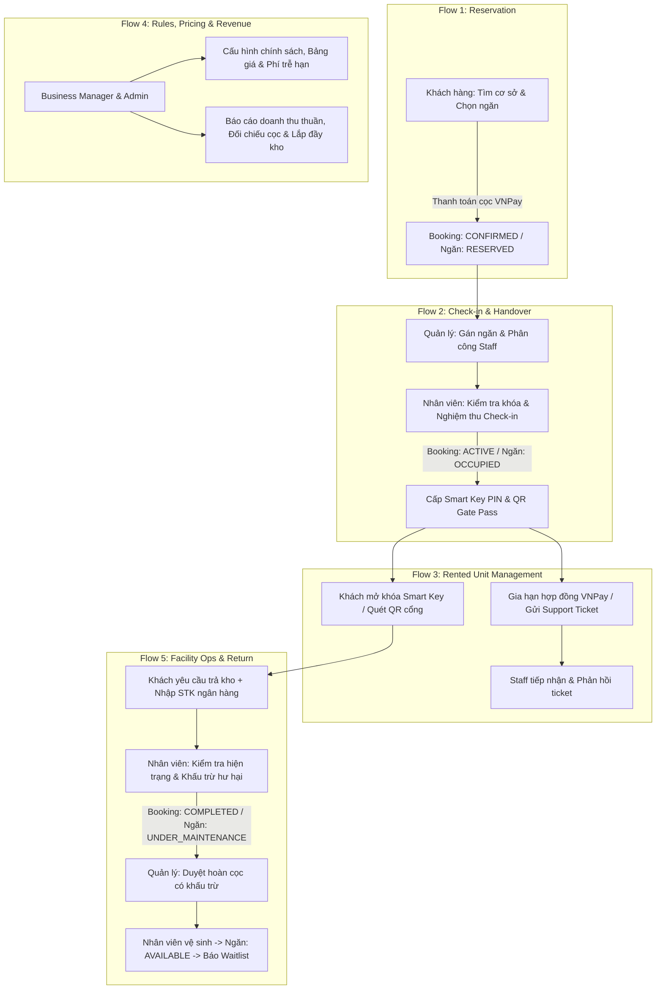

# 📋 HƯỚNG DẪN KIỂM THỬ TOÀN DIỆN HỆ THỐNG KHOMINI
### Self-Storage Facility Rental and Management System (Smart Self-Storage)

> **Tài liệu kiểm thử dành cho:** Giảng viên đánh giá đồ án, Hội đồng bảo vệ, Đội đồng phát triển & QA/Tester.  
> **Phiên bản:** 3.0 (Cập nhật chuẩn 5 Role, 5 Core Flows, phân quyền toàn vẹn cho Admin, hệ thống thông báo đa tầng và giao diện đối chiếu tài chính Fintech).

---

## 📑 MỤC LỤC
1. [Tổng quan hệ thống & Kiến trúc](#1-tổng-quan-hệ-thống--kiến-trúc)
2. [5 Nhóm vai trò (Roles/Actors) & Danh mục chức năng](#2-5-nhóm-vai-trò-rolesactors--danh-mục-chức-năng)
3. [Bảng tài khoản kiểm thử mặc định theo Role](#3-bảng-tài-khoản-kiểm-thử-mặc-định-theo-role)
4. [Bảng dữ liệu mẫu có sẵn để thao tác ngay (Pre-seeded Scenarios)](#4-bảng-dữ-liệu-mẫu-có-sẵn-để-thao-tác-ngay-pre-seeded-scenarios)
5. [Thiết lập môi trường kiểm thử (Quick Start)](#5-thiết-lập-môi-trường-kiểm-thử-quick-start)
6. [Kịch bản kiểm thử 5 Luồng cốt lõi (5 Core Flows)](#6-kịch-bản-kiểm-thử-5-luồng-cốt-lõi-5-core-flows)
   - [Flow 1: Storage Unit Reservation Flow (Đặt giữ chỗ kho)](#flow-1-storage-unit-reservation-flow)
   - [Flow 2: Storage Check-in and Handover Flow (Bàn giao & Nhận kho)](#flow-2-storage-check-in-and-handover-flow)
   - [Flow 3: Rented Storage Unit Management Flow (Quản lý kho đang thuê)](#flow-3-rented-storage-unit-management-flow)
   - [Flow 4: Business Rules, Fee Management, and Revenue Monitoring Flow (Quy tắc, Phí & Doanh thu)](#flow-4-business-rules-fee-management-and-revenue-monitoring-flow)
   - [Flow 5: Facility Storage and Staff Management Flow (Vận hành kho, Nhân sự & Hoàn tất thuê)](#flow-5-facility-storage-and-staff-management-flow)
7. [Kiểm thử các trường hợp đặc biệt & Bảo mật (Edge Cases & Security)](#7-kiểm-thử-các-trường-hợp-đặc-biệt--bảo-mật-edge-cases--security)
8. [Bảng kiểm tra trạng thái vòng đời dữ liệu (State Verification Matrix)](#8-bảng-kiểm-tra-trạng-thái-vòng-đời-dữ-liệu-state-verification-matrix)

---

## 1. Tổng quan hệ thống & Kiến trúc

KhoMini là giải pháp chuyển đổi số toàn diện cho mô hình **Kho lưu trữ cá nhân tự phục vụ thông minh (Smart Self-Storage)**:
- **Backend (BE):** Java 17, Spring Boot 3, Spring Security (JWT RBAC + Facility Scoping), Hibernate/JPA, PostgreSQL, Flyway Database Migration, VNPay Sandbox API, Cloudinary Storage.
- **Frontend (FE):** Flutter Cross-platform (Android, iOS), kiến trúc phân lớp chuẩn Material 3, bảo mật lưu trữ mã PIN cục bộ, giao diện đối chiếu tài chính chuyên nghiệp.



---

## 2. 5 Nhóm vai trò (Roles/Actors) & Danh mục chức năng

### 1. Storage Customer (Khách hàng thuê kho)
- Xem danh sách các cơ sở kho lưu trữ, các loại ngăn, diện tích, bảng giá thuê niêm yết và số lượng ngăn còn trống.
- Đặt giữ chỗ ngăn kho bằng cách chọn cơ sở, loại ngăn, ngày bắt đầu và thời hạn thuê.
- Thanh toán tiền cọc giữ chỗ, tiền thuê kho, phí gia hạn hoặc các khoản phí phát sinh qua VNPay Sandbox.
- Nhận bàn giao ngăn kho theo lịch hẹn tiếp nhận đã đăng ký.
- Quản lý một hoặc nhiều ngăn kho đang thuê trong mục "Kho của tôi": Xem mã PIN an toàn, mở khóa, đóng khóa, đổi PIN, đặt lại PIN khi quên, tạo mã QR ra vào cổng cơ sở.
- Gửi yêu cầu hỗ trợ (Support Ticket) khi gặp sự cố về ngăn kho, ổ khóa, mã PIN, thanh toán hoặc tài sản lưu trữ.

### 2. Facility Staff (Nhân viên cơ sở)
- Tra cứu đơn đặt chỗ của khách khi khách đến cơ sở nhận kho theo lịch hẹn trong ngày.
- Thực hiện quy trình bàn giao nhận kho (Check-in), kiểm tra ổ khóa, tình trạng ngăn; lập biên bản sự cố bàn giao (Handover Defect) nếu ngăn chưa đạt chuẩn để quản lý đổi ngăn cho khách.
- Cập nhật trạng thái ngăn kho sau bàn giao, trong quá trình sử dụng, sau khi khách trả kho, hoặc khi cần bảo trì/vệ sinh.
- Kiểm tra và xác nhận tình trạng ngăn kho khi khách hàng trả kho (Check-out), ghi nhận chi phí hư hại/vệ sinh nếu có.
- Tiếp nhận và xử lý các sự cố tại chỗ (mất chìa khóa, lỗi mã PIN, ngăn hư hỏng, hỗ trợ khách hàng) thông qua hệ thống Support Ticket.
- Theo dõi lịch trình hàng ngày gồm danh sách khách nhận kho, khách trả kho và các yêu cầu hỗ trợ cần giải quyết.

### 3. Facility Manager (Quản lý cơ sở)
- Quản lý toàn bộ danh mục ngăn kho tại cơ sở phụ trách (loại kho, kích thước, vị trí, giá thuê, trạng thái ngăn).
- Phân công và gán ngăn kho phù hợp cho khách hàng dựa trên loại ngăn, thời hạn thuê và tính sẵn sàng; đổi ngăn thay thế khi có báo cáo sự cố bàn giao.
- Giám sát danh sách khách hàng hiện tại, các hợp đồng thuê kho đang hoạt động, thời hạn hợp đồng và trạng thái thanh toán.
- Quản lý quy trình bàn giao kho, nhận trả kho, gia hạn hợp đồng và xử lý trường hợp quá hạn tại cơ sở.
- Phân công nhân viên cơ sở phụ trách lịch hẹn đón khách, nghiệm thu trả kho hoặc xử lý ticket hỗ trợ.
- Phê duyệt hoàn trả tiền cọc cho khách sau khi nhân viên nghiệm thu trả kho, hệ thống tự động sinh mã tham chiếu chuyển khoản ngân hàng và khấu trừ phí hư hại nếu có.
- Xem báo cáo cơ sở về số lượng ngăn trống, ngăn đang thuê, doanh thu, tỷ lệ sử dụng kho và các trường hợp quá hạn.

### 4. Business Operations Manager (Quản lý vận hành kinh doanh)
- Quản lý danh mục toàn bộ các cơ sở lưu trữ trên toàn hệ thống.
- Thiết lập các chính sách thuê kho chung (tỷ lệ đặt cọc, quy định gia hạn, điều khoản hủy đơn, quy trình trả kho, xử lý quá hạn).
- Quản lý khung giá thuê, các khoản phí phụ thu, phí phạt quá hạn và chính sách miễn giảm phí.
- Giám sát doanh thu, tỷ lệ lấp đầy kho và hiệu quả hoạt động kinh doanh của từng cơ sở.
- Xem và xuất báo cáo toàn hệ thống dạng CSV theo cơ sở, loại ngăn, doanh thu thuần và trạng thái đơn thuê.

### 5. System Administrator (Quản trị viên hệ thống)
- Quản lý toàn bộ tài khoản người dùng trong hệ thống (tạo mới, cập nhật, khóa/mở tài khoản).
- Phân vai trò (Role) cho người dùng: Storage Customer, Facility Staff, Facility Manager, Business Operations Manager.
- Cấu hình phân quyền truy cập chức năng (Permissions) theo vai trò và gán cơ sở phụ trách cho Quản lý / Nhân viên.
- Theo dõi lịch sử đăng nhập và nhật ký hoạt động chi tiết (Audit Activity Logs) trên toàn hệ thống.
- Có toàn quyền xem báo cáo doanh thu, đối chiếu tiền cọc ký quỹ và tỷ lệ lấp đầy kho toàn hệ thống.

---

## 3. Bảng tài khoản kiểm thử mặc định theo Role

Tất cả tài khoản đã được nạp sẵn trong hệ thống (Seed Data) với mật khẩu mặc định tương ứng với tên vai trò viết thường:

| Role (Vai trò) | Email đăng nhập | Mật khẩu | Chi nhánh / Cơ sở | Phạm vi dữ liệu & Chức năng |
| :--- | :--- | :--- | :--- | :--- |
| **CUSTOMER** *(Khách 1)* | `customer@gmail.com` | `customer` | Tự do | Đang thuê kho `S-101` (PIN `123456`), kho `M-201` sắp hết hạn, 1 đơn chờ thanh toán. |
| **CUSTOMER** *(Khách 2)* | `customer2@gmail.com` | `customer` | Tự do | Có 1 đơn đã cọc chờ nhận kho (`L-301`), 1 đơn đã trả kho chờ duyệt cọc (`S-102`). |
| **CUSTOMER** *(Khách 3)* | `customer3@gmail.com` | `customer` | Tự do | Đang thuê kho tại Quận 7 (`HCM-D7`), đang trong hàng đợi Waitlist kho Quận 1. |
| **STAFF** *(Nhân viên 1)* | `staff1@gmail.com` | `staff` | HCM-D1 (Quận 1) | Lịch hôm nay (`L-301`), quét QR cổng, bảo trì ngăn `S-102`, xử lý support ticket. |
| **STAFF** *(Nhân viên 2)* | `staff2@gmail.com` | `staff` | HCM-D1 (Quận 1) | Nhân viên trực ca hỗ trợ cơ sở Quận 1. |
| **STAFF** *(Nhân viên 3)* | `staff3@gmail.com` | `staff` | HCM-D7 (Quận 7) | Trực ca cơ sở Quận 7, bàn giao và nghiệm thu kho tại Quận 7. |
| **STAFF** *(Nhân viên 5)* | `staff5@gmail.com` | `staff` | HCM-TD (Thủ Đức) | Trực ca cơ sở Thủ Đức, xử lý tiếp nhận kho tại Thủ Đức. |
| **STAFF** *(Nhân viên 4)* | `staff4@gmail.com` | `staff` | *Chưa gán cơ sở* | Dùng để test tính năng "Gán nhân viên vào cơ sở" của Quản lý cơ sở. |
| **FACILITY_MANAGER** *(Quản lý Q1)* | `facility1@gmail.com` | `facility` | HCM-D1 (Quận 1) | Quản lý ngăn kho Q1, phân công lịch hẹn, duyệt hoàn cọc chuyển khoản, gán ticket. |
| **FACILITY_MANAGER** *(Quản lý Q7)* | `facility2@gmail.com` | `facility` | HCM-D7 (Quận 7) | Quản lý cơ sở Quận 7: kho, nhân sự, đơn thuê và ticket Quận 7. |
| **FACILITY_MANAGER** *(Quản lý Thủ Đức)*| `facility3@gmail.com` | `facility` | HCM-TD (Thủ Đức) | Quản lý cơ sở Thủ Đức: kho, nhân sự, đơn thuê và ticket Thủ Đức. |
| **FACILITY_MANAGER** *(Quản lý dự phòng)*| `facility4@gmail.com` | `facility` | *Chưa gán cơ sở* | Dùng để test tính năng "Gán quản lý cho cơ sở" của Admin. |
| **BUSINESS_MANAGER** *(Quản lý vận hành)* | `business@gmail.com` | `business` | Toàn hệ thống | Quản trị danh sách cơ sở, chính sách thuê, khung giá, báo cáo tài chính & doanh thu, xuất CSV. |
| **ADMIN** *(Quản trị viên)* | `admin@gmail.com` | `admin` | Toàn hệ thống | Quản trị người dùng, vai trò, phân quyền, nhật ký kiểm toán (Audit Logs), xem báo cáo doanh thu & lấp đầy. |

---

## 4. Bảng dữ liệu mẫu có sẵn để thao tác ngay (Pre-seeded Scenarios)

| Mã ngăn / Đơn | Cơ sở | Trạng thái ngăn / Booking | Tài khoản liên quan | Dữ liệu kiểm thử có sẵn | Thao tác kiểm thử nhanh |
| :--- | :--- | :--- | :--- | :--- | :--- |
| **S-101** | HCM-D1 | Ngăn: `OCCUPIED`<br>Đơn: `ACTIVE` | `customer@gmail.com` | PIN: **`123456`** | Mở **Kho của tôi** -> Thử mở cửa, đổi PIN, đặt lại PIN khi quên, tạo QR vào cổng. |
| **M-201** | HCM-D1 | Ngăn: `OCCUPIED`<br>Đơn: `ACTIVE` | `customer@gmail.com` | PIN: **`888999`**, còn 2 ngày | Bấm **Gia hạn thời gian thuê** qua VNPay hoặc bấm **Yêu cầu trả kho**. |
| **M-202** | HCM-D1 | Ngăn: `RESERVED`<br>Đơn: `PENDING_PAYMENT`| `customer@gmail.com` | Đơn chờ thanh toán | Vào tab Khám phá -> Bấm **Thanh toán ngay** hoặc bấm **Hủy đơn**. |
| **L-301** | HCM-D1 | Ngăn: `RESERVED`<br>Đơn: `CONFIRMED` | `customer2@gmail.com` | Lịch hẹn check-in: **Hôm nay** | - Đăng nhập `facility1@gmail.com`: Gán ngăn / gán Staff.<br>- Đăng nhập `staff1@gmail.com`: Vào Lịch hôm nay -> Bấm **Check-in**. |
| **S-102** | HCM-D1 | Ngăn: `UNDER_MAINTENANCE`<br>Đơn: `COMPLETED` | `customer2@gmail.com` | Cọc 500k chờ hoàn tiền | - Đăng nhập `facility1@gmail.com`: Vào **Duyệt hoàn tiền cọc** -> Bấm duyệt.<br>- Đăng nhập `staff1@gmail.com`: Chuyển ngăn về `AVAILABLE`. |
| **TK-HCM-001** | HCM-D1 | Ticket: `IN_PROGRESS` | `customer@gmail.com` | Sự cố khóa thông minh | Đăng nhập `staff1@gmail.com`: Vào Support Ticket -> Cập nhật trạng thái `RESOLVED`. |
| **TK-HCM-002** | HCM-D1 | Ticket: `OPEN` | `customer@gmail.com` | Kẹt cửa ngăn kho | Đăng nhập `staff1@gmail.com`: Bấm **Nhận xử lý (Assign to me)**. |

---

## 5. Thiết lập môi trường kiểm thử (Quick Start)

### 5.1. Khởi động Backend
1. Mở terminal tại thư mục `BE/StoreHub`.
2. Chạy lệnh khởi động Spring Boot:
   ```powershell
   .\mvnw.cmd spring-boot:run
   ```
3. Backend sẵn sàng tại `http://localhost:8080` (Tài liệu API Swagger: `http://localhost:8080/swagger-ui.html`).

### 5.2. Khởi động Flutter Mobile App
1. Mở terminal tại thư mục `FE/storehub_mobile`.
2. Chạy ứng dụng:
   ```bash
   flutter run
   ```
   *(Mặc định Emulator Android kết nối qua `http://10.0.2.2:8080/api/v1`)*.

---

## 6. Kịch bản kiểm thử 5 Luồng cốt lõi (5 Core Flows)

---

### Flow 1: Storage Unit Reservation Flow
*(Khách hàng tìm kiếm, chọn ngăn kho, đặt giữ chỗ và thanh toán cọc VNPay Sandbox)*

#### 🎯 Mục tiêu
Xác thực quy trình xem thông tin cơ sở, chọn loại ngăn, thời hạn thuê, dự toán chi phí minh bạch và hoàn tất thanh toán cọc giữ chỗ.

#### 🚶 Các bước thực hiện:
1. Đăng nhập tài khoản: `customer@gmail.com` / `customer` (hoặc tạo tài khoản mới).
2. Tại thanh điều hướng dưới, chọn tab **Khám phá (Explore)**:
   - Chọn cơ sở: **Kho Mini StoreHub - Quận 1 (HCM-D1)**.
   - Xem danh sách loại ngăn: Ngăn mini, Kho tiêu chuẩn, Kho lớn (kích thước, thể tích, giá thuê tháng).
   - Chọn ngày bắt đầu nhận kho và thời hạn thuê (VD: `1 tháng`).
3. Màn hình hiển thị chi tiết bảng tính chi phí:
   - Tiền thuê tháng: Theo giá niêm yết của loại kho.
   - Tiền đặt cọc bảo đảm: Tính theo chính sách tỷ lệ cọc của hệ thống.
4. Bấm **Xác nhận đặt giữ chỗ**:
   - Hệ thống tạo đơn thuê với trạng thái `PENDING_PAYMENT`.
   - Tự động mở trang thanh toán VNPay Sandbox.
5. **Nhập thông tin thẻ test VNPay NCB:**
   - **Ngân hàng:** Chọn `NCB`.
   - **Số thẻ:** `9704198526191432198`
   - **Tên chủ thẻ:** `NGUYEN VAN A`
   - **Ngày phát hành:** `07/15`
   - **Mã OTP xác thực:** `123456`
6. Bấm **Xác nhận thanh toán**:
   - Giao diện báo thanh toán thành công.
   - Đơn thuê chuyển sang trạng thái **`CONFIRMED`**, ngăn kho chuyển sang **`RESERVED`**.
   - **Xác thực thông báo:**
     - Khách hàng nhận thông báo: *"Đặt cọc thành công đơn [Mã đơn]"*.
     - Quản lý cơ sở nhận thông báo: *"Đơn đặt chỗ mới cần xác nhận"*.
     - Nhân viên cơ sở nhận thông báo: *"Đơn đặt cọc mới tại cơ sở: Khách hàng [Tên] đã đặt cọc..."*.

---

### Flow 2: Storage Check-in and Handover Flow
*(Quản lý gán ngăn/nhân viên, Nhân viên kiểm tra hiện trạng và Bàn giao kho cho khách)*

#### 🎯 Mục tiêu
Xác thực quy trình phối hợp bàn giao kho an toàn giữa Quản lý cơ sở, Nhân viên và Khách hàng; xử lý linh hoạt cả trường hợp ngăn đạt chuẩn và trường hợp phát hiện lỗi (Handover Defect).

#### 🚶 Các bước thực hiện:

##### Bước 2.1: Quản lý cơ sở điều phối đơn đặt chỗ
1. Đăng nhập tài khoản Quản lý cơ sở: `facility1@gmail.com` / `facility`.
2. Mở mục **Gán ngăn & Đơn đặt chỗ (Booking Assignment)**:
   - Kiểm tra đơn `CONFIRMED` vừa tạo ở Flow 1 (hoặc đơn mẫu `L-301`).
   - Quản lý có thể giữ nguyên ngăn hoặc chọn đổi sang ngăn trống khác cùng loại (`AVAILABLE`).
   - Bấm **Xác nhận gán ngăn**: Khách hàng và toàn bộ Staff cơ sở lập tức nhận thông báo *"Xác nhận gán ngăn kho [Mã ngăn]"*.
3. Mở mục **Phân công lịch hẹn (Appointment Assignment)**:
   - Chọn lịch hẹn bàn giao của đơn.
   - Phân công cho nhân viên `staff1@gmail.com`.
   - `staff1@gmail.com` nhận thông báo: *"Bạn được phân công bàn giao nhận kho cho đơn [Mã đơn] lúc [Giờ]"*.

##### Bước 2.2: Nhân viên tiếp nhận và Bàn giao tại cơ sở
1. Đăng nhập tài khoản Nhân viên: `staff1@gmail.com` / `staff`.
2. Vào màn hình **Lịch trình hôm nay**: Xuất hiện lịch hẹn Check-in của khách.
3. Chạm vào đơn để mở bảng bàn giao Check-in:
   - **Kiểm tra trường hợp có lỗi (Defect Flow):**
     - Nếu nhân viên chọn tình trạng ổ khóa là *"Hỏng / cần sửa"* hoặc ngăn *"Chưa sạch sẽ"*, hệ thống tự động khóa nút bàn giao bình thường và chuyển sang nút màu cam: **"Báo cáo kho chưa hợp lệ để đổi ngăn"**.
     - Nhập lý do (VD: *"Khóa kẹt chốt, cần bảo trì"*), chụp ảnh biên bản -> Bấm gửi báo cáo.
     - Ngăn kho tự động chuyển sang `UNDER_MAINTENANCE`. Quản lý cơ sở nhận thông báo để vào đổi ngăn khác cho khách.
   - **Kiểm tra trường hợp đạt chuẩn (Standard Check-in Flow):**
     - Chọn tình trạng ngăn: `Tốt / Sạch sẽ`, tình trạng khóa: `Khóa hoạt động tốt`.
     - Chụp ảnh bàn giao thực tế (tùy chọn), ghi chú nghiệm thu.
     - Bấm **"Xác nhận bàn giao (Check-in)"**.
4. **Kết quả xác nhận:**
   - Đơn thuê chuyển trạng thái sang **`ACTIVE`**.
   - Ngăn kho chuyển trạng thái sang **`OCCUPIED`**.
   - Khách hàng nhận thông báo *"Bàn giao kho thành công"*.
   - Khách hàng được kích hoạt quyền sử dụng Smart Key (PIN 6 số) và Mã QR ra vào cổng.

---

### Flow 3: Rented Storage Unit Management Flow
*(Khách hàng sử dụng Smart Key, Mã QR cổng, Gia hạn hợp đồng và Gửi yêu cầu hỗ trợ)*

#### 🎯 Mục tiêu
Kiểm tra khả năng tự quản lý kho lưu trữ của khách hàng trong suốt thời gian thuê, bảo mật mã PIN, tính tiện dụng của QR vào cổng, và quy trình xử lý sự cố.

#### 🚶 Các bước thực hiện:

##### Bước 3.1: Vận hành Khóa thông minh (Smart Key)
1. Đăng nhập tài khoản `customer@gmail.com` -> Vào tab **Kho của tôi (My Units)**.
2. Chọn ngăn kho đang thuê (`S-101`) -> Bấm **Khóa thông minh ngăn kho**:
   - **Cấp PIN lần đầu:** Bấm *"Hệ thống cấp mã tự động"*, hộp thoại hiển thị mã 6 số to rõ trên nền trắng thanh lịch (VD: `888999`). Bấm *"Tôi đã ghi nhớ"*.
   - **Mở khóa:** Nhập 6 số mã PIN vào ô duy nhất -> Bấm **"Mở khóa ngăn"** -> Trạng thái cửa chuyển sang màu xanh lá: **"Cửa đang MỞ"**.
   - **Đóng khóa:** Bấm **"Đóng khóa ngăn"** -> Cửa chuyển về màu xanh dương: **"Cửa đang KHÓA"**.
   - **Đổi mã PIN:** Bấm *"Đổi mã PIN"*, nhập PIN cũ và chọn tự đặt mã mới hoặc hệ thống cấp -> Bấm Đổi mã -> Cửa tự động khóa an toàn.
   - **Quên mã PIN:** Bấm *"Quên mã PIN?"*, nhập mật khẩu tài khoản (`customer`) -> Hệ thống xác thực và cấp lại mã PIN mới ngay lập tức.

##### Bước 3.2: Sử dụng Mã QR ra vào cổng cơ sở (Gate Pass)
1. Tại màn hình Khóa thông minh, bấm **"Mã QR ra vào cổng cơ sở"**.
2. Bảng điều khiển mở lên với mã QR sắc nét và đồng hồ đếm ngược hiệu lực 60 giây.
3. Đăng nhập tài khoản nhân viên `staff1@gmail.com` -> Mở tính năng **Quét mã QR cổng**.
4. Quét mã QR trên máy khách (hoặc nhập mã văn bản): Hệ thống thông báo *"Duyệt vào cổng thành công - Khách: [Tên khách] - Ngăn: [Mã ngăn]"*.

##### Bước 3.3: Gia hạn hợp đồng thuê kho (Extend Rental)
1. Tại chi tiết ngăn kho, bấm **Gia hạn thời gian thuê**.
2. Chọn thời gian gia hạn thêm (VD: `1 tháng`).
3. Màn hình tính toán số tiền thuê gia hạn tương ứng.
4. Bấm thanh toán qua VNPay Sandbox -> Hoàn tất thanh toán.
5. Hạn hợp đồng tự động được gia hạn thêm; Nhân viên và Quản lý cơ sở nhận thông báo cập nhật thời hạn mới.

##### Bước 3.4: Gửi và xử lý Yêu cầu hỗ trợ (Support Ticket)
1. Khách hàng vào tab **Hỗ trợ** -> Bấm **Tạo yêu cầu mới**.
2. Chọn ngăn kho liên quan, phân loại (Sự cố ổ khóa, Vệ sinh, Thắc mắc), nhập tiêu đề và nội dung mô tả -> Bấm Gửi.
3. Toàn bộ Staff và Quản lý cơ sở nhận thông báo: *"Yêu cầu hỗ trợ mới: [Tiêu đề]"*.
4. Nhân viên `staff1@gmail.com` mở tab **Yêu cầu hỗ trợ**:
   - Bấm **Nhận xử lý (Assign to me)** -> Ticket chuyển sang `IN_PROGRESS`.
   - Cập nhật tiến độ xử lý và nhập nội dung giải quyết -> Bấm **Hoàn tất (RESOLVE)**.
   - Khách hàng nhận thông báo cập nhật trạng thái phản hồi của yêu cầu.

---

### Flow 4: Business Rules, Fee Management, and Revenue Monitoring Flow
*(Quản lý vận hành thiết lập chính sách, giá thuê, giám sát doanh thu & tỷ lệ lấp đầy)*

#### 🎯 Mục tiêu
Xác thực khả năng kiểm soát tập trung toàn hệ thống của Business Operations Manager và System Administrator về chính sách kinh doanh, giá thuê, đối chiếu dòng tiền cọc và tỷ lệ lấp đầy.

#### 🚶 Các bước thực hiện:

##### Bước 4.1: Quản lý Chính sách thuê & Khung giá
1. Đăng nhập tài khoản: `business@gmail.com` / `business`.
2. Mở mục **Cơ sở & Chính sách thuê**:
   - Xem danh sách các cơ sở toàn hệ thống.
   - Chỉnh sửa chính sách: Tỷ lệ đặt cọc (%), số ngày ân hạn quá hạn, phí phạt trễ hạn mỗi ngày, điều khoản hoàn hủy cọc.
3. Mở mục **Giá thuê & Tiền cọc**:
   - Xem và cập nhật đơn giá thuê niêm yết theo từng loại kho (Small, Medium, Large, v.v.).

##### Bước 4.2: Giám sát Doanh thu thuần & Đối chiếu tiền cọc ký quỹ (Ledger Breakdown)
1. Mở mục **Báo cáo doanh thu & lấp đầy**:
   - Chọn bộ lọc khoảng ngày (hoặc xem mặc định kỳ hiện tại).
   - **Thẻ tổng quan:** Hiển thị doanh thu thuần trong kỳ, số lượng giao dịch ghi nhận.
   - **Bảng đối chiếu hạch toán tiền cọc ký quỹ:** Thiết kế dạng sổ cái kế toán 2 cột thanh lịch, minh bạch:
     - `Cọc đầu kỳ:` Số dư từ kỳ trước chuyển sang.
     - `(+) Cọc nhận mới:` Dòng tiền cọc khách đóng khi đặt kho mới (màu xanh lá).
     - `(−) Cọc hoàn trả:` Tiền cọc đã hoàn trả sau khi nghiệm thu trả kho (màu hổ phách).
     - `(−) Cọc giữ lại vi phạm:` Doanh thu ghi nhận từ khấu trừ hư hại hoặc phạt hủy đơn (màu đỏ trầm).
     - `(=) Cọc còn giữ cuối kỳ:` Tổng tiền cọc hệ thống đang nắm giữ để bảo đảm hợp đồng (in đậm, màu navy).
   - Chạm vào thẻ cơ sở để mở **Chi tiết đối chiếu giao dịch**: Bảng kiểm toán hiển thị công thức hạch toán chuẩn chỉ và tổng doanh thu thuần từng cơ sở.

##### Bước 4.3: Giám sát Tỷ lệ lấp đầy kho & Xuất báo cáo CSV
1. Chuyển sang tab **Lấp đầy kho**:
   - Xem thống kê thời gian thực: Tổng số ngăn, số ngăn đang có khách (`OCCUPIED`), số ngăn còn trống (`AVAILABLE`), số ngăn đang giữ chỗ (`RESERVED`), số ngăn đang bảo trì/vệ sinh (`UNDER_MAINTENANCE`).
   - Tỷ lệ lấp đầy (%) được tính toán tự động theo từng cơ sở và theo từng loại ngăn.
2. Bấm nút **Xuất báo cáo (CSV)** trên thanh AppBar:
   - Hệ thống tải và sao chép dữ liệu CSV hoàn chỉnh vào Clipboard.
3. **Quyền hạn của System Administrator:**
   - Đăng nhập `admin@gmail.com` / `admin` -> Vào **Báo cáo doanh thu & Lấp đầy kho**.
   - Admin có toàn quyền xem toàn bộ báo cáo doanh thu, đối chiếu tiền cọc và xuất CSV mà không bị bất kỳ rào cản phân quyền nào.

---

### Flow 5: Facility Storage and Staff Management Flow
*(Quản lý kho cơ sở, Nhân sự, Quy trình trả kho, Nghiệm thu khấu trừ và Hoàn cọc)*

#### 🎯 Mục tiêu
Xác thực trọn vẹn quy trình vận hành kho tại từng cơ sở: quản lý kho vật lý, nhân sự, quy trình nghiệm thu trả kho khách quan (có khấu trừ hư hại nếu có), chuyển khoản hoàn cọc và đưa kho về sẵn sàng cho khách trong hàng đợi.

#### 🚶 Các bước thực hiện:

##### Bước 5.1: Quản lý Kho cơ sở & Phân bổ nhân sự
1. Đăng nhập tài khoản Quản lý cơ sở: `facility1@gmail.com` / `facility`.
2. Tab **Ngăn kho**: Xem danh sách toàn bộ ngăn kho, lọc theo trạng thái (`AVAILABLE`, `OCCUPIED`, `UNDER_MAINTENANCE`), xem lịch sử và vị trí ngăn.
3. Tab **Nhân sự cơ sở**:
   - Xem danh sách nhân viên trực thuộc cơ sở kèm số lượng công việc đang phụ trách (Workload).
   - Thử thêm nhân viên dự phòng (`staff4@gmail.com`) vào cơ sở hoặc gỡ phân công nhân viên.

##### Bước 5.2: Khách hàng Yêu cầu trả kho (Checkout)
1. Đăng nhập `customer@gmail.com` -> Vào ngăn kho `M-201` (hoặc ngăn đang thuê).
2. Bấm **Yêu cầu trả kho (Checkout)**:
   - Chọn ngày giờ hẹn nhân viên cơ sở nghiệm thu.
   - Nhập thông tin tài khoản ngân hàng nhận lại cọc (Ngân hàng, Số tài khoản, Tên chủ tài khoản).
   - Xem lưu ý rõ ràng: Tiền cọc được hoàn lại sau khi nhân viên nghiệm thu và khấu trừ hư hại/vệ sinh (nếu có).
   - Bấm **Xác nhận gửi yêu cầu**.
3. Nhân viên phụ trách và Quản lý cơ sở nhận thông báo: *"Yêu cầu trả kho mới từ khách hàng [Tên] lúc [Giờ]"*.

##### Bước 5.3: Nhân viên Nghiệm thu trả kho & Khấu trừ hư hại
1. Đăng nhập `staff1@gmail.com` -> Vào **Lịch trình hôm nay**, chọn lịch hẹn trả kho.
2. Bấm **Tiến hành nghiệm thu**:
   - Chọn tình trạng ngăn và ổ khóa.
   - **Kịch bản có phát sinh hư hại/vệ sinh:**
     - Tích chọn *"Phát hiện hư hại / vi phạm cần khấu trừ"*.
     - Nhập số tiền khấu trừ (VD: `50.000 ₫`) và lý do (VD: *"Vệ sinh vết sơn bám sàn"*).
     - Chụp ảnh bằng chứng hư hại.
   - Bấm **Xác nhận Check-out**:
     - Đơn thuê chuyển sang **`COMPLETED`**.
     - Ngăn kho chuyển sang **`UNDER_MAINTENANCE`**.
     - Mã PIN Smart Key và mã QR cổng của khách lập tức bị thu hồi hiệu lực.
     - Tạo bản ghi yêu cầu hoàn tiền cọc (Refund Request) với số tiền hoàn = Cọc ban đầu − Chi phí khấu trừ.

##### Bước 5.4: Quản lý phê duyệt Hoàn cọc & Bàn giao ngăn trống cho Hàng đợi
1. Đăng nhập `facility1@gmail.com` -> Mở mục **Duyệt hoàn tiền cọc (Refund Review)**.
2. Danh sách hiển thị đơn trả kho vừa nghiệm thu:
   - Xem rõ: Tiền cọc ban đầu, Số tiền khấu trừ hư hại, Số tiền thực hoàn chuyển khoản cho khách.
   - Xem thông tin tài khoản ngân hàng nhận tiền của khách.
   - Mã tham chiếu chuyển khoản (Reference Code) được hệ thống **tự động sinh ngẫu nhiên chuẩn ngân hàng** (VD: `REF-VCB-782914`), người dùng không cần tự gõ tay.
3. Quản lý kiểm tra biên bản và bấm **"Xác nhận đã chuyển khoản hoàn tiền"**.
4. Khách hàng nhận thông báo: *"Hoàn trả tiền cọc thành công số tiền [Số tiền] ₫"*.
5. Nhân viên `staff1@gmail.com` sau khi vệ sinh xong ngăn kho -> Bấm **"Đã hoàn thành bảo trì/vệ sinh"**:
   - Ngăn kho chuyển trạng thái về **`AVAILABLE`**.
   - Hệ thống tự động gửi thông báo đến khách hàng đang chờ trong Hàng đợi (Waitlist) của loại kho này để đặt chỗ ngay!

---

## 7. Kiểm thử các trường hợp đặc biệt & Bảo mật (Edge Cases & Security)

| Kịch bản kiểm thử | Thao tác thực hiện | Kết quả kỳ vọng đạt chuẩn |
| :--- | :--- | :---: |
| **Nhập sai mã PIN 5 lần** | Nhập sai liên tục 5 lần mã PIN 6 số trên màn hình mở khóa. | Khóa tạm thời chức năng mở trong 15 phút. Hiện đồng hồ đếm ngược `mm:ss`. Nút mở khóa bị vô hiệu hóa. |
| **Đặt lại mã PIN khi bị khóa tạm thời** | Khi đang bị khóa đếm ngược, bấm *"Quên mã PIN?"* và nhập mật khẩu tài khoản. | Đặt lại mã thành công, bộ đếm số lần sai được xóa về 0, mở khóa lại bình thường ngay. |
| **Mã QR cổng hết hạn** | Để đồng hồ QR chạy hết 60 giây rồi mới tiến hành quét. | Hệ thống từ chối truy cập: *"Mã QR đã hết hạn, vui lòng tạo mã mới"*. |
| **Chặn Check-in khi chưa sẵn sàng** | Cố tình bấm Check-in khi ngăn đang bận hoặc khóa bị hỏng mà không báo lỗi. | Hệ thống chặn thao tác, cảnh báo lỗi cụ thể để bảo vệ an toàn kho. |
| **Bảo mật phân quyền ngăn cách chi nhánh** | Nhân viên Quận 7 (`staff3@gmail.com`) cố truy cập dữ liệu của Quận 1 (`HCM-D1`). | Bị chặn `403 Forbidden`, nhân viên chỉ thao tác được trong chi nhánh được gán. |
| **Admin toàn quyền xem báo cáo** | Admin (`admin@gmail.com`) vào mục Báo cáo doanh thu & Lấp đầy kho. | Tải thành công dữ liệu doanh thu, đối chiếu cọc và xuất CSV, không bị 403 Forbidden. |
| **Nhật ký kiểm toán toàn diện** | Admin vào mục Nhật ký hoạt động (Audit Activity Logs). | Ghi nhận chi tiết mọi thao tác: Đăng nhập, Gán quyền, Đặt chỗ, Check-in, Hoàn cọc, Hủy đơn. |

---

## 8. Bảng kiểm tra trạng thái vòng đời dữ liệu (State Verification Matrix)

Để xác nhận tính toàn vẹn của dữ liệu trong quá trình kiểm thử, tester đối chiếu trạng thái của **Booking (Đơn thuê)** và **Storage Unit (Ngăn kho)**:

```
[1. Khách đặt giữ chỗ]
   │  Booking: PENDING_PAYMENT
   │  Unit: AVAILABLE
   ▼
[2. Thanh toán cọc VNPay thành công]
   │  Booking: CONFIRMED
   │  Unit: RESERVED
   ▼
[3. Quản lý gán ngăn & Nhân viên Check-in]
   │  Booking: ACTIVE (Kích hoạt PIN Smart Key & QR Cổng)
   │  Unit: OCCUPIED
   ▼
[4. Khách trả kho & Nhân viên Nghiệm thu]
   │  Booking: COMPLETED (Hủy hiệu lực PIN & QR Cổng)
   │  Unit: UNDER_MAINTENANCE (Khấu trừ hư hại nếu có)
   ▼
[5. Quản lý duyệt hoàn cọc & Nhân viên dọn xong]
   │  Booking: COMPLETED (Đã hoàn cọc qua ngân hàng)
   │  Unit: AVAILABLE (Sẵn sàng đón khách mới / Báo Waitlist)
```

---
*Tài liệu kiểm thử toàn diện hệ thống KhoMini - Cập nhật và nghiệm thu kỹ thuật thành công.*
